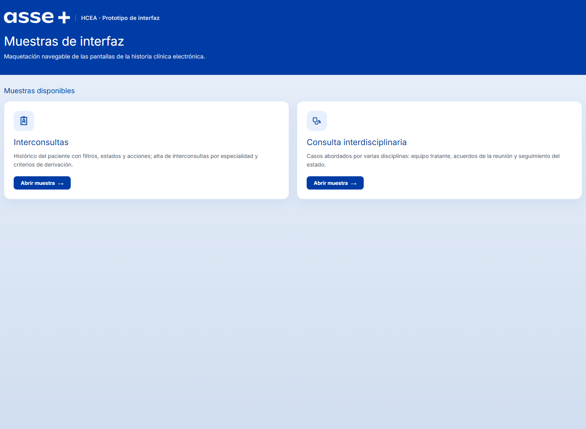
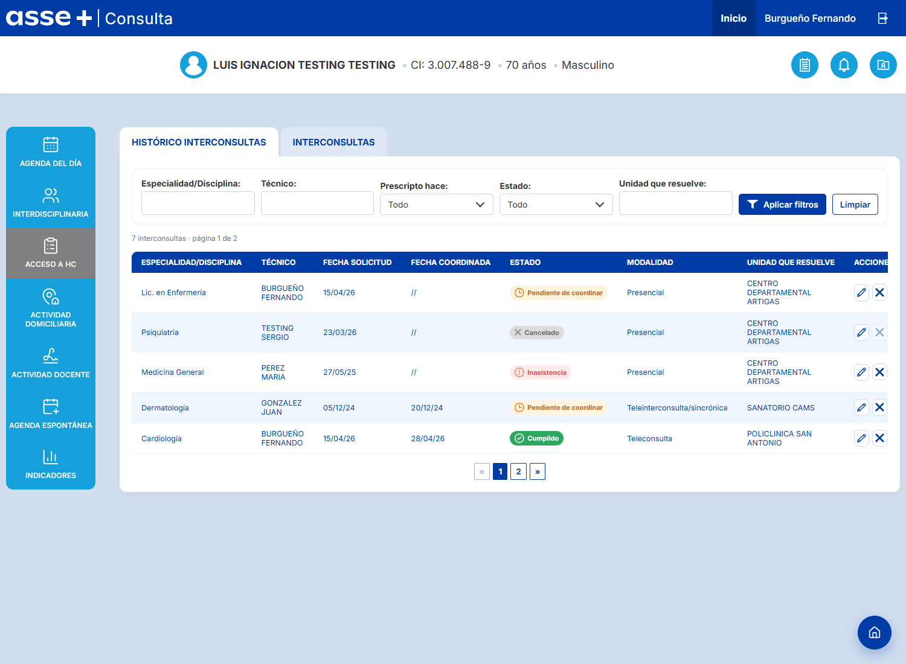
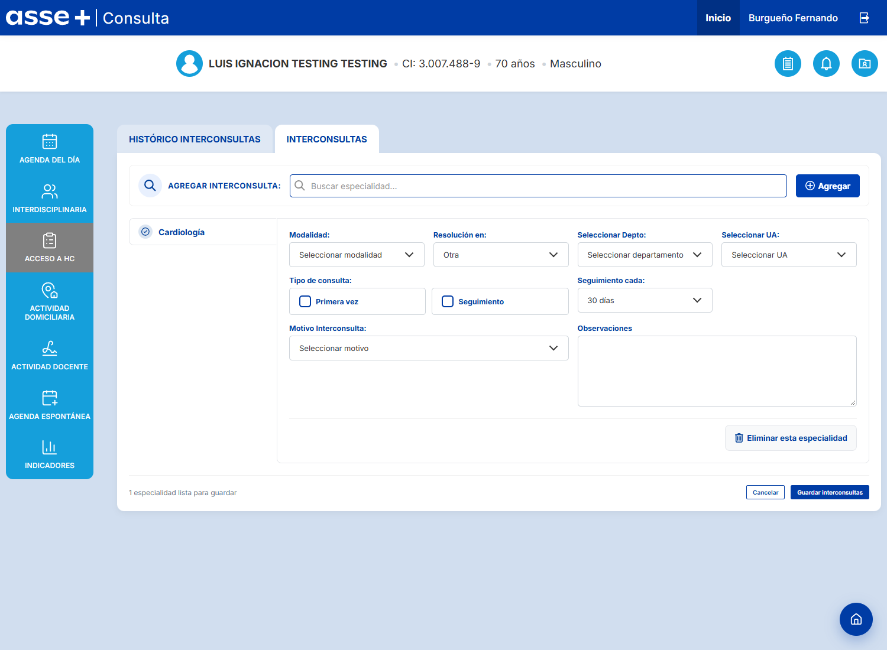
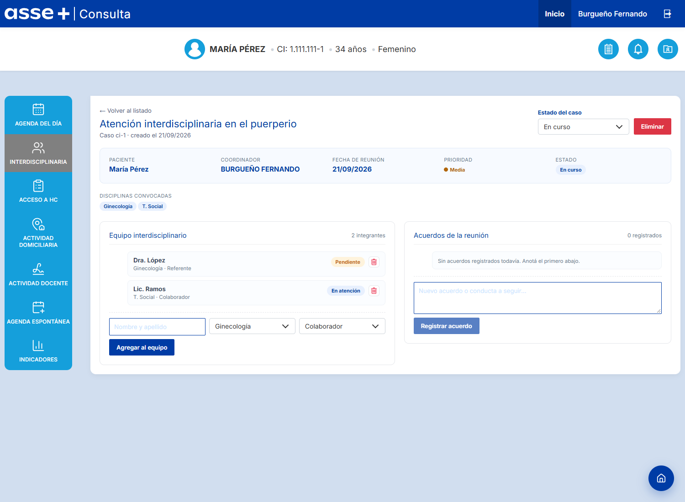

# HCEA · Muestras de interfaz

Maquetación navegable de pantallas de la historia clínica electrónica. Cada muestra funciona con una
**base de datos simulada** en el navegador: se pueden crear, editar y eliminar registros, y los
cambios sobreviven al refresh.

> **Demo:** [https://danielzu22.github.io/Hcea/](https://danielzu22.github.io/Hcea/)

## Capturas

| Portal de muestras | Histórico de interconsultas |
| --- | --- |
|  |  |

| Alta de interconsulta | Detalle de consulta interdisciplinaria |
| --- | --- |
|  |  |

## Stack

- **React 18** + **Vite** (sin TypeScript, sin librería de estado externa).
- **react-router-dom** con `HashRouter`: las rutas funcionan en cualquier hosting estático.
- **lucide-react** para los íconos de interfaz (botón flotante de inicio).
- **Sass** con arquitectura 7-1 y metodología BEM (los estilos originales no se reescribieron).
- Mismo enfoque que `itc.cortex.demo`: semillas en `src/data/*.js` y stores propios con
  `useSyncExternalStore` en `src/store/*.js`. La diferencia es que acá el estado se persiste en
  `localStorage`.

## Puesta en marcha

```bash
npm install
npm run dev       # http://localhost:5190
npm run build     # genera dist/
npm run preview   # http://localhost:5191 (sirve la build)
npm run deploy    # publica dist/ en la rama gh-pages
```

> El puerto 5190 es exclusivo de este proyecto (`strictPort`). Así no se cruza con
> `itc.cortex.demo` ni con otros Vite que usen el 5173.

## Rutas

| Ruta | Pantalla |
| --- | --- |
| `#/` | Portal de muestras (índice) |
| `#/interconsultas` | Histórico de interconsultas (filtros, paginación, edición) |
| `#/interconsultas/nueva` | Alta de interconsultas por especialidad + criterios de derivación |
| `#/interdisciplinaria` | Listado de consultas (una fila por consulta, con equipo y estado) |
| `#/interdisciplinaria/:id/equipo` | Equipo asignado a la consulta (agregar/quitar integrantes) |
| `#/interdisciplinaria/:id/seguimiento` | Registro y firma por integrante (ingreso, firma, estado) |
| `#/interdisciplinaria/equipos` | Equipos de trabajo (grupos de especialistas personales del convocante) |
| `#/interdisciplinaria/nueva` | Alta de un caso con disciplinas convocadas |
| `#/interdisciplinaria/:id` | Detalle: equipo, acuerdos y estado del caso |

## Base de datos simulada

No hay backend. El estado completo vive en memoria y se guarda en `localStorage` con la clave
`hcea.demo.v1` (versión `1`, ver `src/data/seed.js`).

- **Sincronización**: si hay dos pestañas abiertas, los cambios se replican por el evento `storage`.
- **Volver a las semillas**: desde la consola del navegador,
  `localStorage.removeItem('hcea.demo.v1')` y recargar.

Archivos:

- `src/data/seed.js` — semillas (paciente, 7 interconsultas, 3 consultas interdisciplinarias).
- `src/data/catalogos.js` — catálogos fijos (disciplinas, modalidades, estados, criterios, etc.).
- `src/store/db.js` — motor: suscripción, persistencia y generación de ids.
- `src/store/interconsultas.js` — acciones de interconsultas (alta, edición, estado, baja).
- `src/store/interdisciplinaria.js` — acciones de casos, participantes y acuerdos.

Los componentes leen con `usarDb()` y escriben llamando a las acciones; nunca mutan el estado a mano.

## Estructura

```
src/
├─ assets/            íconos SVG, logos asse, fuentes Inter e icon-font
├─ components/
│  ├─ layout/         Header, PatientBanner, VerticalMenu, SampleShell
│  ├─ ui/             Icon, Select, Modal, ConfirmModal, Pagination, StatusPill, TabsMuestra, BotonInicio
│  └─ interconsultas/ Filtros, TablaHistorico, ModalEdicion, Buscador, FormEspecialidad, ModalCriterios
├─ data/              catálogos y semillas
├─ lib/               utilidades de fecha
├─ pages/             Portal + muestras (interconsultas, interdisciplinaria)
├─ store/             base simulada y acciones
├─ styles/            SCSS 7-1 (abstracts, base, layout, components, utilities)
├─ App.jsx            rutas
└─ main.jsx           entrada (HashRouter)
```

## Cómo agregar una muestra nueva

1. Agregá las semillas en `src/data/` y, si aplica, un store en `src/store/`.
2. Creá los componentes en `src/components/<muestra>/` reutilizando `SampleShell` y los componentes de `ui/`.
3. Creá la página en `src/pages/<muestra>/` y sumá la ruta en `src/App.jsx`.
4. Sumá la tarjeta en el array `MUESTRAS` de `src/pages/Portal.jsx`.
5. Si hace falta CSS nuevo, creá el parcial en `src/styles/components/` y agregalo a `src/styles/main.scss`.

## Migración desde Grunt

El proyecto original (Grunt + `grunt-bake` + `funciones.js`) quedó archivado en `_legacy/` como
referencia visual y de contenido: `_legacy/src` (HTML, SCSS, JS, assets), `_legacy/dist` (build
anterior), `_legacy/Gruntfile.js` y el `package.json` original. Cuando la migración esté validada
se puede borrar esa carpeta.
